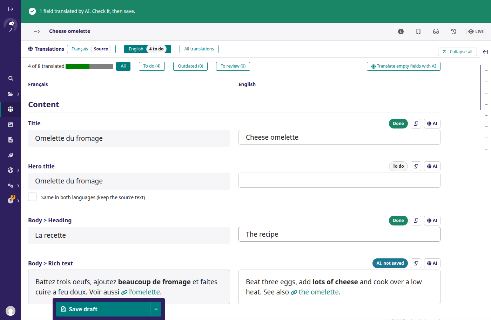
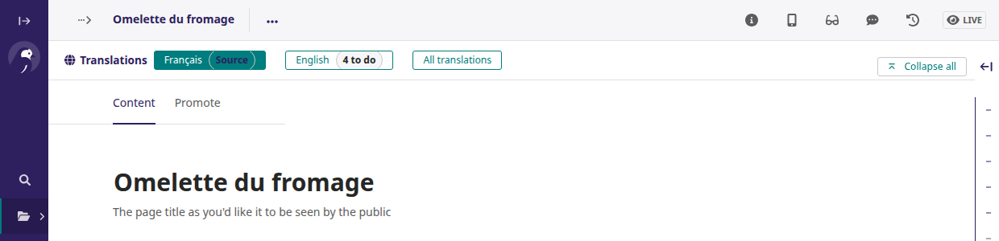
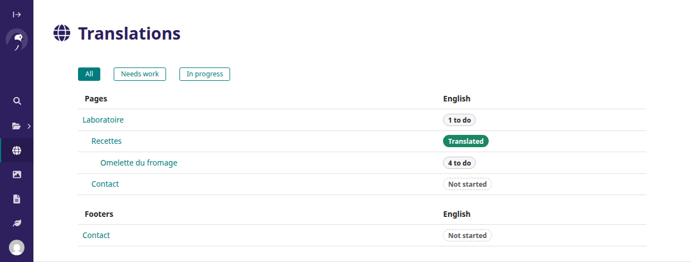
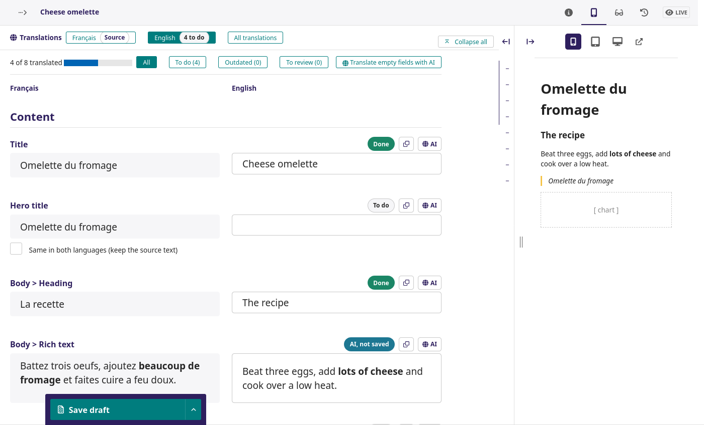

# wagtail-sidebyside

> **Why this exists:** we built it because the existing translation solutions
> for Wagtail were simply not good enough for us. Editors translated one string
> at a time without seeing the page, saving and publishing were separate from
> Wagtail's own flow, So we made the editor we wanted: the whole page,
> side by side, one save.
>
> **Made with Claude:** this package was designed and written together with
> [Claude Opus 5.5](https://www.anthropic.com/claude) (Anthropic), in Claude
> Code, by a developer at [PythonUnited](https://github.com/PythonUnited).

Translate Wagtail pages side by side. One main language, every other language
is a translation of it. The editor sees the source next to the translation,
field by field, and saves or publishes the whole page at once. Optional machine
translation with AI.



- **Side by side**: every text of the page in one screen, including StreamField
  blocks, the slug and the SEO fields, in the order of the editor.
- **One save**: "Save draft" and "Publish" for the whole translation, with
  Wagtail's own action menu, revisions, history and live preview.
- **Knows what changed**: every field is *to do*, *done*, *outdated* (with a
  word diff of the source change) or *to review* (AI or reused text).
- **Tree in sync**: new source pages get their translations; moving,
  unpublishing and deleting cascade. A translation is never published ahead of
  its source.
- **AI** (optional): translate one field or all empty fields with Claude, with a
  glossary, house style instructions and a monthly budget.
- **Built on Wagtail core i18n** (`Locale`, `TranslatableMixin`): no extra
  translation tables, no monkey patching. Extend it with hooks.

| The source page | All translations |
| --- | --- |
|  |  |

Live preview while translating:



## Requirements

Python 3.12+, Wagtail 8.1+.

## Install

```bash
pip install wagtail-sidebyside            # without machine translation
pip install "wagtail-sidebyside[claude]"  # with machine translation by Claude
```

```python
INSTALLED_APPS = [
    "wagtail_sidebyside",  # before wagtail.admin: it extends the page editor
    # ...
    "wagtail.contrib.settings",
    "wagtail.locales",
    "wagtail.admin",
    "wagtail",
    # ...
]

WAGTAIL_I18N_ENABLED = True
WAGTAIL_CONTENT_LANGUAGES = LANGUAGES = [("fr", "Francais"), ("en", "English")]

SIDEBYSIDE = {
    "SOURCE_LOCALE": "fr",  # the main language; default: Wagtail's default locale
}
```

```bash
python manage.py migrate
```

Add the locales under Settings > Locales. New source pages get their
translations right away; for existing pages the translation bar above the page
has a button to create them. Editors find all work under **Translations** in
the menu.

## Settings

All in the `SIDEBYSIDE` dict:

| Key | Default | |
| --- | --- | --- |
| `SOURCE_LOCALE` | Wagtail's default locale | Language code of the main language. |
| `TRANSLATOR` | `"wagtail_sidebyside.translators.claude.ClaudeTranslator"` | Machine translation backend, see below. |
| `AI_PROVIDER` | `""` (off) | Claude: `"anthropic"` or `"foundry"` (Microsoft Foundry / Azure). |
| `AI_MODEL` | `"claude-opus-5-5"` | Claude model. |
| `AI_PRICES` | built in | `{model: (input, output)}` in USD per million tokens, for the cost estimate. |

Fields that are the same in every language (an image, a colour) go in the page
model:

```python
class BlogPage(Page):
    translation_exclude = ["header_image"]
```

Choice fields and blocks without text are copied from the source anyway.

## Machine translation

With Claude directly, create a key at [platform.claude.com](https://platform.claude.com)
(tip: in a workspace with a spend limit) and put it in the server's
environment, not in a settings file:

```bash
ANTHROPIC_API_KEY=sk-ant-api...
```

```python
SIDEBYSIDE = {"SOURCE_LOCALE": "fr", "AI_PROVIDER": "anthropic"}
```

Through Microsoft Foundry: `"AI_PROVIDER": "foundry"` with
`ANTHROPIC_FOUNDRY_API_KEY` and `ANTHROPIC_FOUNDRY_RESOURCE`.

Editors manage the rest in **Settings > Translations**: switch AI on or off,
a monthly budget (the AI buttons hide when it is reached), a glossary
(`fromage = cheese`) and instructions for tone and style. The page also shows
this month's usage and a "Test connection" button.

AI never saves by itself: a machine translation is marked *to review* until an
editor saves it.

## Extending

### Another translation service

Subclass `Translator` and point `SIDEBYSIDE["TRANSLATOR"]` at it:

```python
from wagtail_sidebyside.translators import TranslationError, Translator, Usage


class DeepLTranslator(Translator):
    def available(self):
        return bool(os.environ.get("DEEPL_KEY"))

    def translate(self, items, source, target, glossary="", instructions=""):
        # items: [(text, is_html), ...]; source/target: language names
        texts = ...  # call the service, raise TranslationError on failure
        return texts, Usage(input_tokens=..., output_tokens=...)
```

Optional: `status()` and `status_template` for the settings screen, `check()`
for "Test connection", `cost(usage)` for the budget.

### Hooks

Standard [Wagtail hooks](https://docs.wagtail.org/en/stable/reference/hooks.html),
in your app's `wagtail_hooks.py`:

```python
from wagtail import hooks


@hooks.register("sidebyside_block_kind")
def block_kind(block):
    """How a leaf block is translated: "text", "textarea", "richtext",
    "html", "image", "document", False (not translatable) or None (default)."""
    if isinstance(block, MapBlock):
        return False


@hooks.register("sidebyside_construct_rows")
def construct_rows(rows, source, target):
    """Change the rows of the translation screen in place."""
    rows[:] = [row for row in rows if row.unit.path != "seo_title"]


@hooks.register("sidebyside_before_save_translation")
def before_save(request, source_page, target_page):
    """Return a response to stop the save."""


@hooks.register("sidebyside_after_save_translation")
def after_save(request, source_page, target_page, revision):
    """Return a response to replace the redirect."""
```

## Coming from wagtail-localize

Both use Wagtail core i18n, so pages and their translations stay as they are.
wagtail-sidebyside treats the translated text already on the pages as done.
One catch: wagtail-localize only writes a translation into the page when it is
published. Translations that were entered but never published live only in
wagtail-localize's own tables. Step 1 saves those as drafts before
wagtail-localize goes. On a live site, deploy step 1 and step 2 separately.

**Step 1: install next to wagtail-localize**

```python
INSTALLED_APPS = [
    "wagtail_sidebyside",       # before wagtail.admin
    "wagtail_localize",         # stays for now
    "wagtail.locales",          # instead of "wagtail_localize.locales"
    "wagtail.contrib.settings",
    # ...
]
```

```bash
pip install "wagtail-sidebyside[claude]"
python manage.py migrate
python manage.py import_localize_drafts --dry-run   # lists the waiting translations
python manage.py import_localize_drafts             # saves them as drafts
```

Live pages are not changed; the drafts show up in the side-by-side screen
as work to finish.

**Step 2: remove wagtail-localize**

```bash
python manage.py migrate wagtail_localize zero   # drops its tables
```

Then:

- remove `"wagtail_localize"` (and `"wagtail_localize.modeladmin"` if used)
  from `INSTALLED_APPS`;
- remove `wagtail-localize` from your requirements;
- remove `translatable_fields` and the `wagtail_localize` imports from your
  models. Fields that were a `SynchronizedField` (the same in every language)
  go in `translation_exclude`;
- remove any templates or code that use `wagtail_localize`.

## Development

```bash
uv sync
uv run pytest
uv run python -m tests.demo   # demo site on http://localhost:8000/cms/ (admin/admin)
```

The demo uses a fake translator, so no API key is needed.

## License

MIT, see [LICENSE](https://github.com/PythonUnited/wagtail-sidebyside/blob/main/LICENSE).
